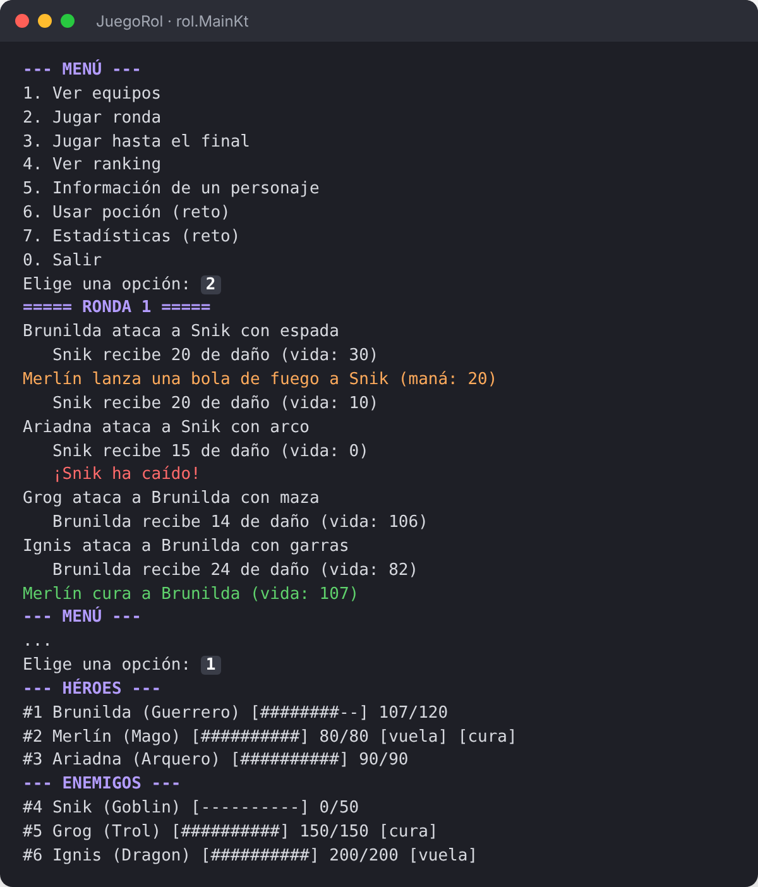

<div align="center">

# ⚔️ JuegoRol

### Juego de rol por turnos en consola, escrito en Kotlin

Tres héroes contra tres enemigos: espadas, bolas de fuego, flechas, curaciones y un dragón.<br>
Solución del ejercicio «Juego de rol por turnos» · *Desarrollo de Interfaces* · 2º DAM

[](https://kotlinlang.org/)
[](https://gradle.org/)
[](https://learn.microsoft.com/java/openjdk/)
[](https://ccnl10.github.io/JuegoRol/api/)

[**Cómo jugar**](#jugar) ·
[**Personajes**](#personajes) ·
[**Clases**](#clases) ·
[**Documentación**](#documentacion) ·
[**API**](https://ccnl10.github.io/JuegoRol/api/)



<sub>Captura de una partida real. Los colores se han añadido a la imagen para que se lea mejor: el juego escribe en el color normal de la consola.</sub>

</div>

---

## ✨ Qué es

Un combate por turnos entre dos equipos. En cada ronda los héroes atacan, los enemigos responden y los sanadores curan a los suyos. Tú decides cuándo avanzar, consultas cómo va la batalla y das pociones a tus héroes en el momento justo.

- 🛡️ **Seis personajes distintos**, cada uno con su vida, su arma y su regla especial.
- 🔥 **Habilidades compartidas** entre bandos: curar y volar.
- 🧪 **Inventario de pociones** y **estadísticas** de la partida.
- 📚 **Todo el código documentado con KDoc**, con una [página web de la API](https://ccnl10.github.io/JuegoRol/api/).

<a id="jugar"></a>

## 🎮 Cómo jugar

**Requisitos:** JDK 17 o superior e IntelliJ IDEA. La primera vez hace falta Internet para que Gradle descargue lo necesario.

1. Clona el repositorio o descárgalo con **Code → Download ZIP**:
   ```bash
   git clone https://github.com/ccnl10/JuegoRol.git
   ```
2. En IntelliJ, **File → Open** y elige la carpeta `JuegoRol` (la que contiene `build.gradle.kts`). Pulsa **Trust Project** y espera a que Gradle termine.
3. Abre `src/main/kotlin/rol/Main.kt` y pulsa el ▶ verde junto a `fun main()`.

| Opción | Qué hace |
|:-:|---|
| **1** | Ver los dos equipos con su barra de vida |
| **2** | Jugar una ronda |
| **3** | Jugar hasta que gane un equipo |
| **4** | Ranking de vida |
| **5** | Información de un personaje |
| **6** | Usar una poción 🧪 |
| **7** | Estadísticas 📊 |
| **0** | Salir |

> [!TIP]
> Los enemigos atacan siempre al héroe con más vida, y Merlín solo tiene maná para tres bolas de fuego. Juega ronda a ronda y guarda las pociones para cuando Brunilda las necesite.

<a id="personajes"></a>

## 🧙 Personajes

| | Personaje | Clase | Vida | Daño | Especial |
|:-:|---|---|:-:|:-:|---|
| 🛡️ | **Brunilda** | Guerrero | 120 | 20 | Armadura: recibe menos daño · solo la mitad contra quien vuela |
| 🔮 | **Merlín** | Mago | 80 | 20 / 10 | Bola de fuego mientras tenga maná · cura 25 · vuela |
| 🏹 | **Ariadna** | Arquero | 90 | 15 | 10 flechas; después, puñetazo de 2 |
| 👺 | **Snik** | Goblin | 50 | 8 | 30 de oro |
| 🧌 | **Grog** | Trol | 150 | 20 | Cura 15 · 150 de oro |
| 🐉 | **Ignis** | Dragón | 200 | 30 | Vuela · 500 de oro |

<details>
<summary><b>¿Cómo se juega una ronda?</b></summary>
<br>

1. Cada héroe vivo ataca al **primer enemigo vivo**.
2. Cada enemigo vivo ataca al **héroe con más vida**.
3. Los sanadores de cada equipo curan al **compañero herido con menos vida**.

El combate termina cuando cae un equipo entero. Con la partida inicial, los héroes ganan en **12 rondas** y consiguen **680 de oro**.

</details>

<a id="clases"></a>

## 🧩 Diseño de clases

<p align="center">
  
</p>

<p align="center"><sub>Flecha continua: hereda · Flecha discontinua: implementa una interfaz · Fondo gris: clase abstracta</sub></p>

| Concepto de Kotlin | Dónde se usa |
|---|---|
| Clase abstracta y herencia | `Personaje` → `Guerrero`, `Mago`, `Arquero`, `Enemigo` → `Goblin`, `Trol`, `Dragon` |
| Sobrescritura con `super` | `Guerrero.calcularDano()` y `recibirDano()`, `Mago.atacar()`, `Arquero.atacar()` |
| Interfaces con métodos con cuerpo | `Sanador.curar()`, `Volador.volar()` |
| Setter personalizado | `Personaje.vida`, siempre entre 0 y la vida máxima |
| `companion object` | Contador de `id` de los personajes |
| `enum class` con propiedades | `Arma(texto, dano)` |
| `data class` | `Pocion`, clave del inventario |
| `object` | `Partida`: equipos, rondas e inventario |
| Función de extensión | `Personaje.barraVida()` |
| Colecciones | `filter`, `find`, `maxByOrNull`, `minByOrNull`, `groupBy`, `sortedByDescending` |

<details>
<summary><b>Ver la estructura de carpetas</b></summary>

```text
JuegoRol/
├── build.gradle.kts            Plugins de Kotlin y application
├── settings.gradle.kts
├── docs/                       Manuales, API e imágenes
└── src/main/kotlin/rol/
    ├── Personaje.kt            Personaje y barraVida()
    ├── Arma.kt                 enum class Arma
    ├── Habilidades.kt          Sanador y Volador
    ├── Heroes.kt               Guerrero, Mago y Arquero
    ├── Enemigos.kt             Enemigo, Goblin, Trol y Dragon
    ├── Partida.kt              object Partida y data class Pocion
    └── Main.kt                 Menú y main()
```

</details>

<a id="documentacion"></a>

## 📚 Documentación

| Documento | Para quién | Contenido |
|---|---|---|
| 📘 [Manual de usuario](docs/Manual_Usuario_JuegoRol.pdf) | Jugadores y alumnado | Cómo se instala y se juega, con un ejemplo de cada opción |
| 🛠️ [Manual técnico](docs/Manual_Tecnico_JuegoRol.pdf) | Quien mantenga o amplíe el juego | Modelo de clases, reglas del combate, Gradle, distribución y cómo añadir personajes |
| 🔎 [API](https://ccnl10.github.io/JuegoRol/api/) | Programadores | Cada clase, propiedad y función, con buscador y enlaces |

## ➕ Ampliar el juego

- **Nuevo personaje:** hereda de `Personaje` o de `Enemigo`, da su `ataqueBase` y, si quieres, implementa `Sanador` o `Volador`.
- **Nueva arma:** añade un valor a `Arma`, por ejemplo `HACHA("hacha", 9)`.
- **Nueva habilidad:** crea una interfaz en `Habilidades.kt` y úsala en `Partida.jugarRonda()`.

---

<div align="center">
<sub>Desarrollo de Interfaces · 2º DAM · IES Virrey Morcillo (Villarrobledo) · Curso 2026-2027</sub>
</div>
